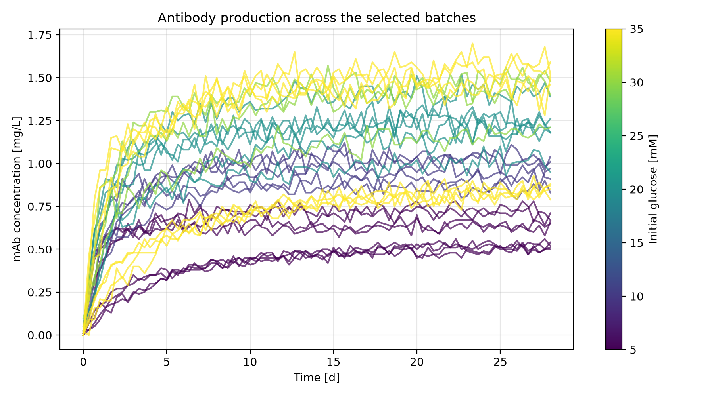
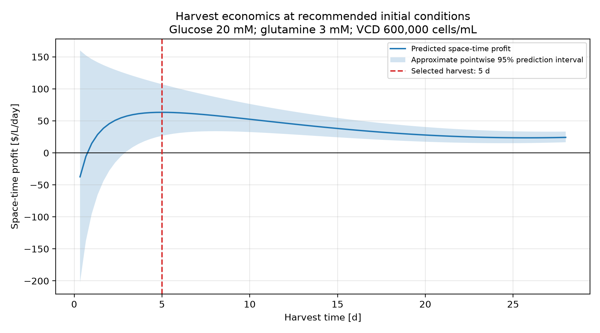
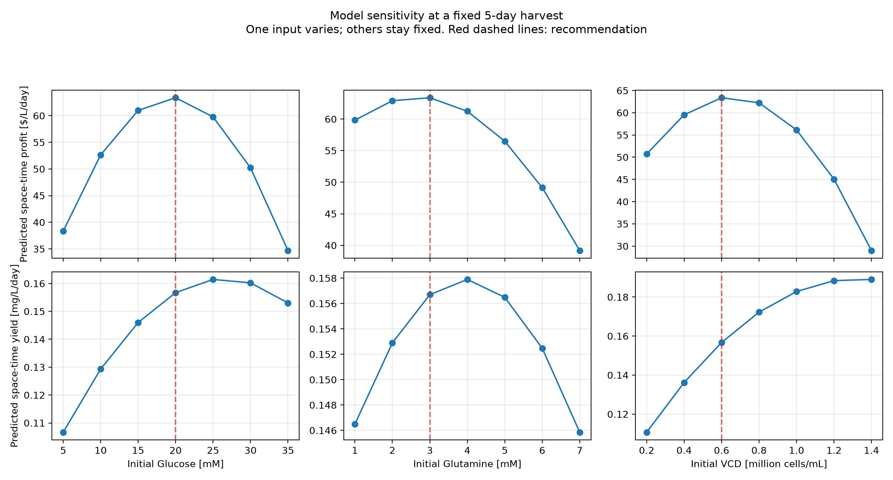
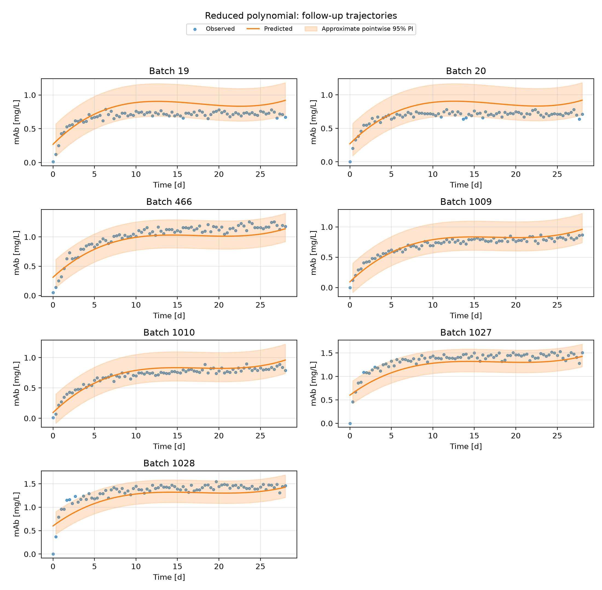

# Optimizing Antibody Production

This project uses simulated batch culture data to recommend initial glucose, glutamine, viable cell density, and harvest time for monoclonal antibody production. It compares regression models, evaluates their harvest decisions, and searches for conditions that maximize profit per litre per day. The analysis includes culture costs, downtime between batches, prediction intervals, and figures showing the trade-off between antibody yield and profitability.

## Highlights

- Selected 30 batch runs to cover a range of starting conditions and include repeated experiments.
- Compared polynomial regression, k-nearest neighbours, and recursive forecasting using grouped cross-validation.
- Evaluated models using both concentration errors and the economic consequences of harvest decisions.
- Identified operating conditions that maximize predicted space-time profit on the available search grid.
- Estimated prediction intervals and visualized the effects of nutrients, cell density, and harvest timing.

## Environment

The analysis uses Python with the following libraries. **Replace the version placeholders with the versions from the environment used to generate the results before publishing the final README.**

- Python: 3.14.7
- Matplotlib: 3.11.0
- NumPy: 2.5.2
- pandas: 3.0.5
- scikit-learn: 1.9.0

`pathlib` is included with Python and requires no separate installation. To display the versions, run this command in the project's activated environment:

```bash
python -c "import platform, matplotlib, numpy, pandas, sklearn; print('Python:', platform.python_version()); print('Matplotlib:', matplotlib.__version__); print('NumPy:', numpy.__version__); print('pandas:', pandas.__version__); print('scikit-learn:', sklearn.__version__)"
```

Run the analysis from the project folder:

```bash
python main.py
```

The `datasets/` folder must contain `initial_conditions.csv` and the 30 selected batch files. The program creates `figures/` and `tables/` as needed. The current `environment.yaml` must also be replaced with an actual environment export; it presently contains template text. From the activated environment, run `conda env export > environment.yaml` and remove the machine-specific `prefix:` entry before committing it.

## Code Design

### Loading and checking the batch data

The workflow begins by loading the initial-condition table and the 30 selected batch files. Each measurement receives a batch identifier from its filename. The measurements are combined into one table and sorted by batch and time. Initial glucose, glutamine, and viable cell density are then attached to every measurement from the corresponding batch. Keeping these nominal starting conditions separate from measured concentrations is necessary because the production cost depends on the starting recipe, while the culture changes throughout the run.

Before modelling, the program checks the required columns, batch count, numeric values, missing values, and measurement times. Each batch must start at zero and use the same sampling grid. These checks prevent invalid data from entering the models and ensure that a forecasting step represents the same time interval in every batch. File paths are defined relative to the project files so that the analysis can run from different working directories.

### Keeping related batches together

The next stage identifies groups of batches with identical initial conditions. Replicates belong to the same group because they represent repeated runs of the same recipe. A reproducible split reserves 20% of the condition groups using a random state of zero. This produces 23 development batches covering 16 conditions and seven follow-up batches covering four conditions.

Four-fold grouped cross-validation is applied to the development data. Each fold trains on three parts and evaluates the remaining part, with complete condition groups kept together. This avoids having measurements or replicates from the same recipe on both sides of a validation split. The condition assignments are exported so the split can be checked. The seven reserved batches were examined during earlier model development, so their later results are explicitly labelled as follow-up evidence.

### Comparing prediction approaches

Recursive models use the seven current process measurements to predict the next process state. Training pairs are created within each batch, so a pair never crosses a batch boundary. During full-batch evaluation, forecasting starts from the nominal initial conditions and continues using predicted states as the next inputs. Linear regression and k-nearest neighbours provide two alternatives for this approach.

Direct models instead predict mAb concentration from initial glucose, initial glutamine, initial viable cell density, and harvest time. Linear, quadratic, cubic, reduced polynomial, and k-nearest-neighbour models are compared using the same validation groups. A mean-trajectory reference predicts the average training-batch concentration at each time. Pipelines fit the scaler and regression model using only the training portion of each fold. This is particularly useful for kNN because the input variables have very different numerical scales.

### Evaluating accuracy and harvest decisions

Predictions are scored separately for each validation batch using RMSE and R². The initial measurement is excluded from scoring, and batch scores are averaged with equal weight. Negative predictions are counted rather than silently changed. These checks show both average accuracy and variation between batches.

The program also converts predicted mAb concentrations into space-time profit at each possible harvest time. For each batch, it selects the harvest time with the highest predicted profit rate, then uses the observed data to evaluate that decision. The difference between the best observed profit rate and the observed profit rate at the selected time is the STP gap. This connects model evaluation to the actual operating objective. Polynomial design checks provide additional evidence about whether the available data support the number of fitted coefficients.

### Searching conditions and estimating uncertainty

The selected reduced polynomial is fitted using the development batches. The search combines all 343 supplied initial-condition combinations with the 84 positive recorded harvest times. Negative concentration predictions are excluded from recommendations. The remaining candidates are ranked by predicted space-time profit, including the one-day downtime, and the best harvest time for each recipe is exported.

Approximate 95% prediction intervals are calculated from the selected model's out-of-fold validation residuals. The 2.5th and 97.5th percentiles of observed minus predicted concentration are added to a new prediction. The concentration limits are converted into limits for culture value, space-time profit, and space-time yield using the same economic equations. Follow-up coverage is reported by batch. Finally, the program saves four figures and supporting CSV tables, while the terminal displays a concise summary and the recommended operating point.

## Analysis

### Selecting the 30 batch runs

The available dataset contains 1,029 simulated runs: seven glucose levels, seven glutamine levels, seven initial viable cell densities, and three replicates of every combination. With only 30 runs available for modelling, the selection needed to capture differences across the input range without using all runs at one recipe. The selected batches cover low and high values, intermediate conditions, and repeated runs. They represent 20 distinct initial-condition combinations, with ten combinations represented twice.

The selected batch IDs are:

```text
1, 2, 19, 20, 127, 128, 145, 146, 178, 179,
214, 226, 262, 466, 478, 514, 515, 550, 562, 766,
802, 814, 883, 884, 901, 902, 1009, 1010, 1027, 1028
```

Selection was based on the starting conditions rather than observed antibody production. Including boundary combinations helps describe behaviour near the limits of the available inputs, while intermediate combinations provide information about curvature. Replicates help reveal differences between runs at the same conditions. This balances coverage and repetition, although 20 distinct recipes remain a small sample of the 343 possible combinations. The selected conditions and development/follow-up assignments are recorded in [condition_split.csv](tables/condition_split.csv).

Each batch contains 85 measurements over 28 days, separated by eight hours. The trajectories generally rise rapidly before approaching a plateau, but both the rise time and final concentration vary between batches. The colour scale below indicates initial glucose. Glutamine and cell density also vary, so differences between coloured curves cannot be attributed to glucose alone.



### Choosing the regression model

The direct approach is well suited to the decision being made: before a batch starts, the available choices are the starting recipe and harvest time. It predicts concentration from these four inputs without repeatedly feeding predictions back into the model. Recursive forecasting was also considered because it uses changes in all seven process variables, but errors can accumulate over a complete batch.

The direct polynomial comparison included degrees one, two, and three. The kNN comparison used 5, 15, and 30 neighbours with uniform and distance weights. Recursive kNN used the same neighbour counts with uniform weights. These small grids provide reasonable comparisons while keeping model selection understandable. Standard scaling was included in each pipeline and learned within each training fold.

The selected reduced polynomial includes all linear terms, squares, and pairwise interactions of the four scaled inputs, plus a cubic term for time alone. It uses ordinary linear regression to fit these terms. This gives the time trajectory additional flexibility without including every possible cubic interaction between the initial conditions. Including the intercept, the model has 16 coefficients.

| Model | Mean batch RMSE [mg/L] | SD of batch RMSE [mg/L] | Mean batch R² |
|---|---:|---:|---:|
| Reduced polynomial | 0.1248 | 0.0443 | -0.6933 |
| Quadratic regression | 0.1343 | 0.0445 | -0.7710 |
| Full cubic regression | 0.1511 | 0.1003 | -0.7224 |
| Linear VAR | 0.2429 | 0.1219 | -7.2014 |
| Direct kNN, 30 neighbours, distance weights | 0.2623 | 0.1687 | -10.9319 |
| Mean trajectory | 0.3113 | 0.1777 | -7.9559 |
| Recursive kNN, 30 neighbours | 0.3849 | 0.2111 | -10.5936 |

Source: [complete model comparison](tables/model_comparison.csv). Standard deviations describe differences between batch errors, rather than uncertainty in the reported mean.

The reduced polynomial has the lowest mean validation RMSE among the compared models. However, its negative mean batch R² shows that prediction quality is still limited. R² compares errors with the variation within each individual batch; relatively flat trajectories can receive poor scores even when concentration errors appear modest. Averaging these scores across batches is different from calculating one R² for the complete dataset. Both RMSE and the plotted trajectories are therefore needed to interpret performance.

The full cubic model also had a structural weakness. Its 35 coefficients were supported by a design matrix with rank 31 across all development data and rank 27 within each training fold. Some terms could not be independently estimated from the selected conditions. The reduced model had full rank in all subsets. These [design checks](tables/polynomial_design_checks.csv) support limiting model complexity rather than choosing a higher degree simply because it can fit more shapes.

### Comparing harvest decisions

Concentration accuracy alone does not show whether a model chooses useful harvest times. A small prediction error near the profit maximum may have little effect, while an error that causes premature harvest can be expensive. For this reason, model comparison also considered the observed STP gap and the absolute error in predicted STP at the selected harvest.

| Model | Mean STP gap [$/L/d] | Worst STP gap [$/L/d] | Harvest STP MAE [$/L/d] | Missed profitable batches |
|---|---:|---:|---:|---:|
| Reduced polynomial | 14.135 | 42.808 | 8.467 | 0 |
| Full cubic regression | 15.649 | 37.448 | 12.942 | 0 |
| Direct kNN, 5 neighbours, uniform weights | 20.824 | 54.286 | 60.407 | 1 |
| Mean trajectory | 25.205 | 48.158 | 52.796 | 5 |
| Quadratic regression | 34.674 | 375.833 | 31.385 | 2 |

Source: [harvest model comparison](tables/harvest_model_comparison.csv). A missed profitable batch has a positive best observed STP but a negative observed STP at the model-selected harvest.

The reduced polynomial combines the lowest mean concentration error with the lowest mean STP gap and harvest STP MAE in this comparison. The full cubic model has a slightly smaller worst gap, so the reduced model is not better on every measure. Its overall validation performance and supported number of coefficients provide the main reasons for selecting it. The quadratic model's much larger worst gap also shows why ranking models by RMSE alone would be insufficient.

### Recommended conditions and economics

The operating search evaluated 28,812 combinations of initial conditions and positive harvest times. Four candidates with negative predicted mAb were excluded. The highest predicted space-time profit occurred at the conditions below. This is the best candidate on the searched grid; the analysis does not establish a continuous or experimentally confirmed global optimum.

| Operating choice | Recommendation |
|---|---:|
| Initial glucose | 20 mM |
| Initial glutamine | 3 mM |
| Initial viable cell density | 600,000 cells/mL |
| Harvest time | 5 days |
| Downtime between batches | 1 day |

The economic calculations use the specified relationships, with concentration in mg/L and harvest time in days:

```text
Cost = 10 × initial glucose + 20 × initial glutamine + 0.0005 × initial VCD
Value = 1000 × mAb concentration
Profit = Value − Cost
Space-time profit = Profit / (harvest time + 1)
Space-time yield = mAb concentration / (harvest time + 1)
```

| Quantity at the recommendation | Estimate | Approximate 95% prediction interval |
|---|---:|---:|
| mAb concentration [mg/L] | 0.9402 | 0.7202–1.2034 |
| Culture cost [$/L] | 560.00 | Fixed by the recipe |
| Culture value [$/L] | 940.21 | 720.16–1,203.44 |
| Profit [$/L] | 380.21 | — |
| Space-time profit [$/L/d] | 63.37 | 26.69–107.24 |
| Space-time yield [mg/L/d] | 0.1567 | 0.1200–0.2006 |

Source: [operating predictions and intervals](tables/operating_prediction_intervals.csv).

At five days, the six-day total cycle produces a predicted profit of approximately $380 per litre. Continuing the batch increases the time for which the reactor is occupied, while additional antibody production becomes smaller. The predicted profit rate therefore decreases after its broad maximum near five days. The relatively flat region around the maximum suggests that nearby harvest times may have similar predicted performance.



The best observed point among the selected runs was batch 466 at two days, with 20 mM glucose, 2 mM glutamine, and 400,000 cells/mL. Its observed mAb concentration of 0.73 mg/L gives an STP of $96.67/L/d, above the model recommendation's predicted $63.37/L/d. This observed maximum is a useful reference, but selecting the largest noisy measurement is different from estimating performance at a proposed recipe. The model underpredicts concentration at that reference point, and the prediction intervals overlap substantially. The recommendation should therefore be tested in additional batches before claiming that it improves on the observed reference. Full observed results are available in [best_observed_harvest_per_batch.csv](tables/best_observed_harvest_per_batch.csv).

### Effects of initial conditions

The sensitivity figure changes one input at a time while holding the other inputs at their recommended values and fixing harvest at five days. These curves describe the fitted model within the supplied input range. They do not establish isolated biological effects from controlled experiments.

Increasing glucose initially improves both predicted yield and profit. Profit peaks at 20 mM, while yield peaks nearer 25 mM. The difference occurs because additional glucose increases culture cost, and the added production eventually does not compensate for that cost. Glutamine shows a similar trade-off: profit is highest near 3 mM, whereas the largest predicted yield is near 4 mM. The small difference in predicted profit between 2 and 3 mM should be considered alongside the uncertainty of the model.

Increasing initial VCD raises predicted space-time yield across most of the plotted range, with diminishing gains at higher densities. Profit instead peaks near 600,000 cells/mL and then declines as the inoculum cost increases. These results demonstrate why maximizing antibody production alone would lead to different operating choices from maximizing space-time profit.



### Follow-up performance and limitations

Across the seven follow-up batches, mean RMSE was 0.1173 mg/L, mean batch R² was 0.0952, and mean observed STP gap was $8.475/L/d. Harvest STP MAE was $9.920/L/d. Two batches were classified as missed profitable batches, and no negative concentration predictions occurred in this follow-up assessment. The [follow-up summary](tables/reduced_followup_summary.csv) and [batch scores](tables/reduced_followup_batches.csv) provide the supporting results.

The plots show persistent overprediction for batches 19 and 20, closer agreement for batches 1009 and 1010, and underprediction over parts of the other trajectories. The polynomial also predicts nonzero concentration at startup and a late upward turn that does not closely follow the observed plateaus. These are limitations of fitting a flexible polynomial without enforcing the process's starting value or plateau shape. Twelve negative predictions occurred during development validation, which is another reason to restrict interpretation to the evaluated range.



The residual interval endpoints were approximately −0.2201 and +0.2632 mg/L. Mean follow-up coverage was 97.6%, but high coverage does not remove systematic bias or prove the model is accurate for every recipe. Measurements within a batch are related, and the intervals pool errors across different times and conditions. They are approximate pointwise prediction intervals, not uncertainty intervals for the location of the optimum. The narrowing STP band at later times also partly follows directly from dividing concentration uncertainty by a longer cycle time.

Finally, these follow-up conditions had already been examined during an earlier cubic-model assessment. Although the reduced model was fitted on development batches only, the follow-up results cannot be treated as a fresh independent final test. The limited number of distinct recipes, previous examination of the reserved data, and visible prediction errors should accompany the recommendation. Additional independent runs near the proposed operating point would provide the most useful next check of both profitability and uncertainty.
